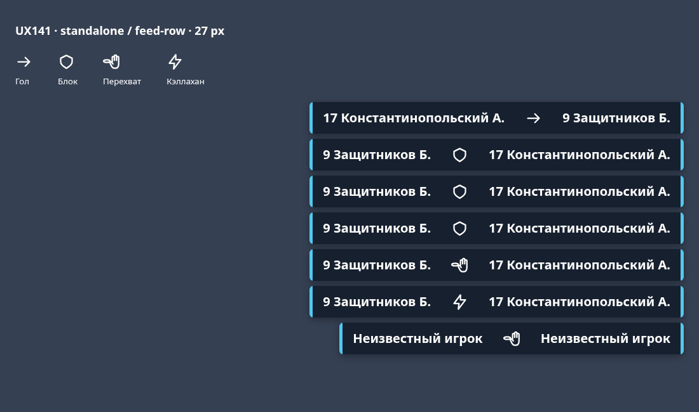
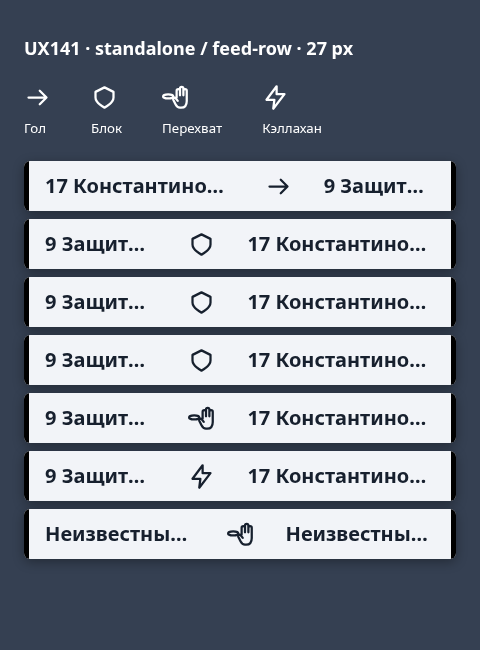

# OBS event markers visual check

Run the regular regression suite with `node --test src/test/js/*.test.mjs`.

The optional Chromium probe uses an existing Playwright installation, without
adding application dependencies. From the repository root:

```sh
NODE_PATH=/path/to/existing/node_modules \
  flock -s /tmp/ultistats-browser-network.lock node tools/obs141/check.cjs
```

Set `CHROMIUM_PATH` if Chromium is not `/usr/bin/chromium`; set `OBS141_OUTPUT`
to choose an evidence directory (default `/tmp/ultistats-ux141-browser`). The
probe starts and closes its own loopback server on a dynamically assigned port.
It checks the actual shared renderer and CSS, including all block variants,
player roles, SVG accessible names, 27px bounds, connected row/animation
stability, narrow Cyrillic names, UNKNOWN, custom colors and transparency.
It writes three screenshots at device scale 1 and a JSON result. Standalone
icons are clones of the rendered feed SVGs. Labels appear only in the preview
legend, never as feed badges.

Human readability and actual OBS Browser Source acceptance remain QA/PO checks;
geometry assertions and Chromium screenshots alone do not establish those.

The interception is an original SVG outline: a flat disc on the left and an
upright catching hand on the right, matching the user correction. No external
vector paths or icon dependencies are included.

Reference Chromium captures (device scale 1):




